# florilegium

See the [verified compatibility baseline](docs/project/BASELINE.md) for current build evidence, reproducible commands and sample provenance. Tracked root PDFs are historical snapshots; the baseline links fresh generated PDFs for the tested revision and identifies outdated sample prose.

## Origin

The [Reddit post](https://www.reddit.com/r/LaTeX/comments/1xixznw/how_do_you_make_these_flowers_in_latex/)
asked how to make flowers like these in LaTeX. I don't know how the original was made, and
this project doesn't try to reproduce it. It is one possible way, and the way I did it:
hand-authored primitives with randomized parameters, painted in Lua, placed by a procedural
layout whose "fill the unused space" part borrows a 1998 idea from the ornament literature.
It gets a similar look.

## What it is

Procedurally generated Delft-blue floral page margins for LuaLaTeX and XeLaTeX.
Every petal, leaf and stem is a parametric curve computed in Lua and painted like a
watercolor. LuaLaTeX writes the paths directly; XeLaTeX places generated vector PDFs
from the same renderer. There are no stock images or traced illustrations.

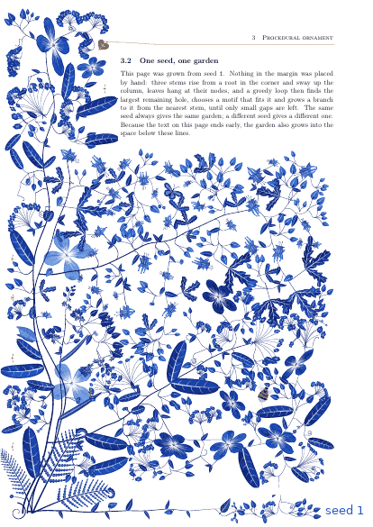

*Six seeds of the grown composition. Same code, different seed — and the garden fills
whatever space the text leaves free.*

Two documents share one package, and a third shows what else it does:

| | `florilegium.tex` | `florilegium-grow.tex` |
|---|---|---|
| composition | **authored**: stems, leaves and flowers placed by hand, every parameter sampled | **grown**: a plant grown to fit the page by a greedy space-filling loop |
| adapts to | nothing (tuned for A4, 68 mm margin) | the page layout, and the free space below the text on the last page |
| preview | 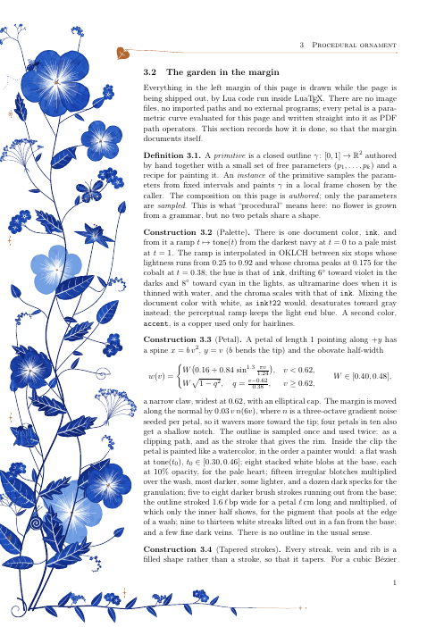 | 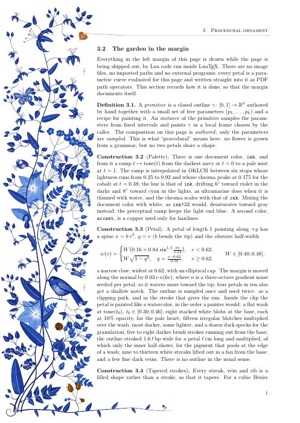 |

Both PDFs are self-describing: the body text is the write-up of how the margin is drawn.

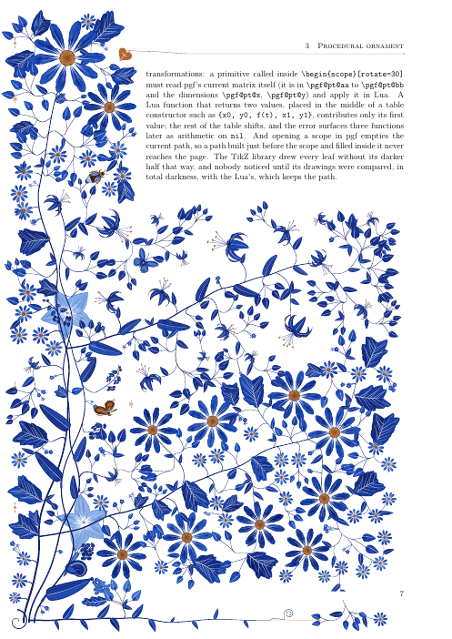

*Last page of the grown document: the text ends early, so branches arch into the space below.*


*300 dpi crop. Mottled washes with white streaks lifted out, lobed leaves with white veins,
forget-me-not cymes, a pale ghost flower behind the stems.*

## Botanical books and folios

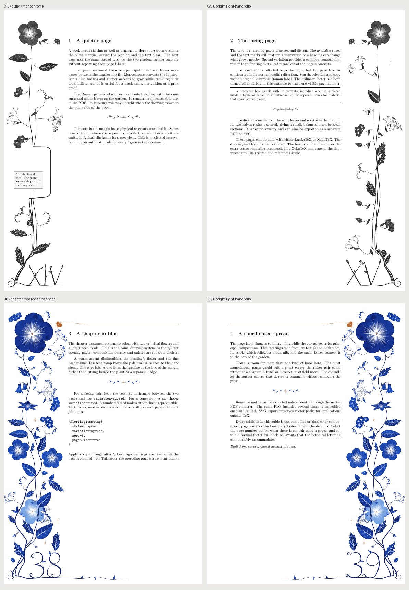

[folio-demo.tex](folio-demo.tex) is a four-page design guide. It demonstrates upright
Arabic/Roman page labels, coordinated spreads, grayscale print artwork, protected
notes and matching section dividers. The default composition remains unchanged.

```tex
\documentclass[twoside]{book}
\usepackage[inner=24mm,outer=68mm,bindingoffset=4mm]{geometry}
\usepackage[grown,side=outer,style=quiet,pagenumber,
  variation=spread,seed=17]{florilegium}
\pagestyle{empty} % Configure your own footer explicitly.
```

| Control | Default | Behavior |
| --- | --- | --- |
| `pagenumber` | `false` | Grow the page label from the plant's base. Arabic digits and Roman-letter forms are supported. Labels remain searchable and upright in either margin. |
| `number-scale` | `1` | Desired label height, from `0.5` to `1.25`; available width still limits the size. |
| `variation` | `page` | `spread` shares a seed across logical even/odd facing pages; `fixed` reuses one seed index. Geometry, text marks, seasons and reservations still affect placement. |
| `seed` | `auto` | Integer `0..2^31-1` for reproducible variation. The legacy `\florilegiumseed` macro takes precedence when supplied. |
| `color-mode` | `color` | `mono` emits DeviceGray illustration colors, including the accent. It is also a package option for authored or standalone drawings. |

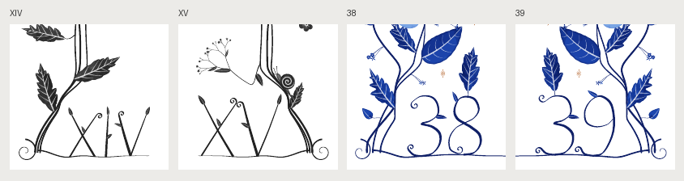

The page-number option does not take over the document's page style. This guide
uses `\pagestyle{empty}` to avoid a second visible footer. Book classes may force
`plain` on chapter openings; the supplied template explicitly clears that style too.
Keep a normal footer
when using unsupported labels, very narrow margins, or reservations covering the
label area: botanical lettering is then omitted with a diagnostic. With
`footer=false`, a label retains a short baseline inside the side column while the
long under-text footer is absent.

Monochrome applies to newly rendered paths. Included PDF assets retain their
exported colors; create a gray version with `--color-mode=mono` when needed.

`\florilegiumdivider[36mm]` places a centered vector fleuron made from the garden's
leaves and rosette. The optional argument sets its width. It works in either
composition and with `nomargin`; `divider` is also an exportable motif.

Spread, seed and lettering controls require `grown`. Use a clear page before
changing a shipped-page treatment. Custom focal sizes are constrained to the
column and their stem tips ease inward so enlarged flowers remain whole.

## Layout controls in this fork

The grown composition has controls for density and deliberate whitespace. The
defaults retain the upstream drawing. These additions work with both TeX engines;
the PostScript port still uses the original layout.

```tex
\usepackage[grown,density=airy,spill=false]{florilegium}
\florilegiumsetup{footer=false,text-gap=6mm}
```

| Control | Default | Effect |
| --- | --- | --- |
| `density` | `full` (`1`) | `balanced` (`0.6`), `airy` (`0.3`), or a number from `0.2` to `1`. Lower values space leaves farther apart and reduce secondary branches, ghost flowers and finishing details. Main stems and terminal motifs remain. |
| `text-gap` | `1.5mm` | Minimum side clearance between the text edge and the garden's clipping boundary, including its existing 2.5 mm overhang. Accepts a nonnegative TeX dimension. |
| `spill` | `true` | `false` preserves the area below the final paragraph even when `\florilegiumtextend` is present. |
| `footer` | `true` | `false` removes the bottom stem, its leaves and its tail. |
| `header` | `true` | `false` removes the garden's ivy leaf and header rule; document headers are separate. |

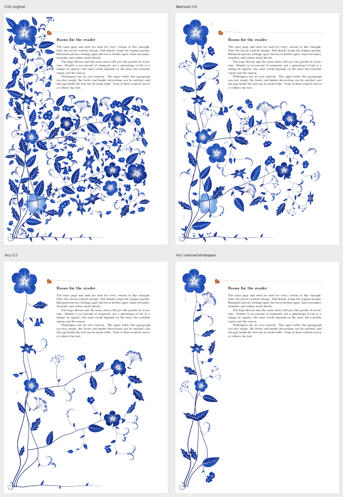

The comparison uses identical text, geometry and seed, without visitors. Density
controls ornament amount, not opacity or a measured percentage of ink; exact
counts depend on the seed, season and available region. A lower density can
rearrange secondary motifs.

Use `\florilegiumsetup{...}` to change any subset of controls. Settings persist
until changed and are read when a page is shipped out. Put `\clearpage` before a
style change to keep the previous page's appearance. All five controls require
`grown`; they do not alter text layout or standalone primitives. Leave at least
18 mm for the growth column in addition to `text-gap` and the 2.5 mm overhang.
The header rule and the optional under-text/footer regions have their own
switches; `text-gap` controls only the side garden.

Build the four comparison PDFs in `build/` and this contact sheet with
`make layout-preview` (Python, Pillow and `pdftoppm`, as for the galleries).
`make check` checks the upstream path fingerprints, density controls, LaTeX
options and animation end frames. Use `CHECK_SEEDS="1 6"` for more seeds, or
`RUN=tools/in-docker` to use the build image.

## Book sides and protected content

```tex
\documentclass[twoside]{article}
\usepackage[inner=22mm,outer=68mm,bindingoffset=3mm]{geometry}
\usepackage[grown,side=outer,style=chapter,sections]{florilegium}
```

`side=left` is the default. `right` reflects the ornament onto the physical right
margin. `outer` and `inner` follow page parity in a two-sided document; in a
one-sided document they mean right and left. Even-page margins, binding offsets,
and horizontal/vertical page offsets are included. Only the drawing is reflected.
Allocate a wide enough margin on the selected side (the same 18 mm minimum growth
column applies).

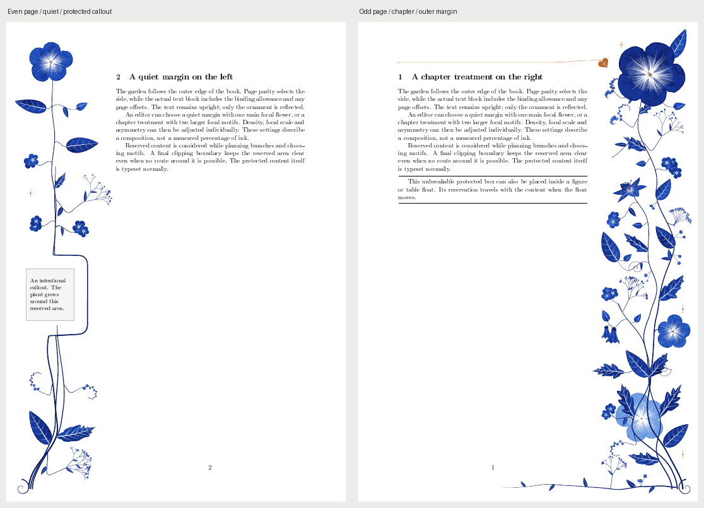

To protect a selected figure, table, equation or callout, wrap its content in an
unbreakable box. Inside a float, put the protection environment **inside** the
`figure` or `table`, around its contents:

```tex
\begin{figure}[tbp]
  \begin{florilegiumprotect}[4mm]
    \includegraphics[width=\linewidth]{my-figure.pdf}
    \caption{A figure whose reservation moves with it.}
  \end{florilegiumprotect}
\end{figure}
```

The optional padding defaults to 3 mm. This box cannot break across pages; use
separate boxes for multi-page material. It does not automatically reserve every
float in the document. For a fixed physical page region, use:

```tex
\florilegiumreserve[3mm]{12mm}{112mm}{30mm}{32mm}
% padding, x, y, width, height; origin is the physical page's lower-left corner
```

The command reserves space on the page containing its marker. Rectangles remain
in physical page coordinates on mirrored pages. The layout removes their area
from the growth grid, routes feasible stem detours and omits motifs whose drawing
bounds overlap them. Sequential PDF clips provide a final guarantee, including
overlapping reservations and header ornament. A reservation that cuts off all
routes can leave a clipped/disconnected stem; enlarge the margin or reduce the
reservation if continuity is important. Reserved content is typeset normally.

## Composition styles

| Style | Density | Main terminal motifs | Focal scale | Stem asymmetry | Spill / footer / header |
| --- | --- | --- | --- | --- | --- |
| `classic` | 1 | 3 | 1 | 1 | on / on / on |
| `quiet` | 0.3 | 1 | 0.75 | 0.45 | off / off / off |
| `chapter` | 0.6 | 2 | 1.2 | 1.35 | off / on / on |

`classic` preserves the original defaults. `quiet` also avoids large secondary
statement motifs and uses smaller heading blossoms. Set `style` first, then
override individual controls:

```tex
\clearpage
\florilegiumsetup{style=quiet,density=0.4,focal-count=2,focal-scale=0.9,asymmetry=0.6}
```

`focal-count` is an integer from 0 to 3 and applies to the three main stems, not
every small flower or heading mark. `focal-scale` accepts 0.5 to 1.5. `asymmetry`
accepts 0 to 2 and controls stem waviness and spread; it does not impose exact
whole-page symmetry. A style resets the fields in the table, leaving `side` and
`text-gap` intact. All layout changes still take effect at shipout.

## Vector export and smaller repeated-asset PDFs

```sh
python3 tools/exportasset.py flower --seed 7 --size 1.2 --ink 2456C4 --output build/assets/flower
make export-check
```

The exporter uses `texlua` and Inkscape 1.x to produce a transparent vector PDF
and a plain SVG, without a LaTeX compilation. `--renderer=lualatex` selects the
reference TeX route; `--color-mode=mono` exports grayscale artwork. It rejects conversions containing embedded raster images.
Supported motifs are listed by `--help`; size is 0.1 to 2, seed is 0 to 2^31-1,
and ink is a six-digit HTML color. The canvas is at least 6 cm square and expands
for a large divider, ivy stem or drifting seed head to avoid cropping. Exported SVGs
were checked with Inkscape; rendering in Office is not tested by this repository.
The [starter assets](examples/assets) include flower, leaf and butterfly SVG/PDF
pairs under the repository's MIT license.

```tex
\florilegiumdeclareasset{flower}{examples/assets/flower.pdf}
\florilegiumuseasset[width=18mm]{flower}
```

These commands work in either composition and with `nomargin`. PDF inclusion
reuses the same Form XObject instead of writing the paths at every occurrence.
In the 48-repeat native-export benchmark, the local PDF decreased from 995,950 to
23,931 bytes (97.6%); raster comparisons had a mean channel error of 0.053/255.
This result concerns repeated identical assets, not unique random gardens.
`asset-demo.tex` shows the starter set; `make export-check` reproduces the
benchmark and writes current measurements to `build/assets/reuse-report.json`.

## Headings and initial fonts

The `sections` option wraps the public section/subsection commands, plus chapters
when present, after heading packages finish loading. Numbered headings receive
flowers; starred headings retain their normal behavior. Short titles keep markers
out of contents, running titles and bookmarks. Checks cover standard `article`,
KOMA-Script `scrartcl`/`scrbook`, `titlesec` loaded before and after florilegium,
and `hyperref` references.

If the initial's font file, glyph outline or luaotfload reader is unavailable,
the default is a visible plain initial and a diagnostic instead of a Lua crash.
The text remains searchable. Use the package option `initial-fallback=error` to
require the decorated outline. An initial must be exactly one visible Unicode
character. This fallback applies to either composition.

`make check` now includes book/heading/font and obstacle checks.
`make book-preview` renders the facing-page example; `make export-check` needs
Inkscape, Pillow and Poppler in addition to TeX Live.

## Watch it grow

| as it grows | with the free space it fills |
|---|---|
|  |  |

*Seed 6, from an empty margin to the finished page. The stems rise first, leaves open as
the tips pass their nodes, and each stem ends in a flower. Then the greedy loop takes over:
on the right, each dashed circle is the largest free disc it found, just before a branch
grows to it. Big holes come first and slowly, small ones last and fast. The butterflies and
bees fly in, the bird glides onto its twig, and the snail crawls up its stem until the last
frame, which is exactly the page this seed always gives.*

The growth is recorded once, while the page is laid out: each stem is also drawn as
prefixes of increasing length and each motif at a few smaller scales, replaying the same
random draws. A frame then writes the pieces whose time has come, in their original
painting order. `make grow-6` renders one seed this way (`build/grow-6.gif` and `.mp4`, about
45 seconds); add `EXPLAIN=1` for the dashed circles.

## The margin reads the text

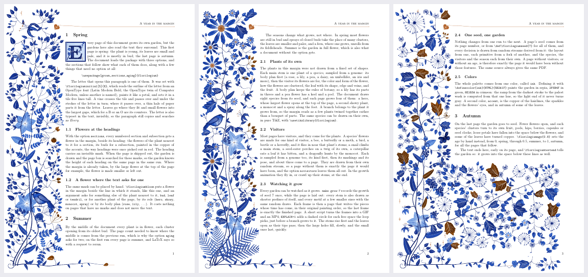

*`showcase.tex`, "A year in the margin": spring on the first page, summer, autumn on the
last. Each section describes the feature it shows.*

The grown margin can respond to the document around it:

- **Initials.** `\florilegiuminitial[5]{E}` sets the first letter of a paragraph in a tile
  five lines tall. The outline of the letter is read from an OpenType font (Latin Modern
  Bold by default) and painted like a petal; a vine passes over and under its strokes in
  turn, with leaves where they fit and flowers in the gaps, often in the letter's counters.
  The letter is also typeset invisibly, so the paragraph still copies as "Every".
- **Flowers at the headings.** With the option `sections`, every numbered section and
  subsection gets a flower in the margin beside its heading, painted in the copper of the
  accents, the way headings were once picked out in red.
- **A flower where the text asks.** `\florilegiumbloom` puts a flower beside the line it
  stands in; `\florilegiumbloom[lily]` asks for any motif of the garden. The marks are found
  in the page box when the page is shipped out, so this works in one run.
- **Seasons.** With the option `aging`, the garden ages from spring on the first page
  (mostly in bud, small pale leaves) to autumn on the last (seed heads, falling petals, a
  few copper leaves). It needs two runs, for the page count; `\florilegiumage{0.8}` sets an
  age by hand instead.


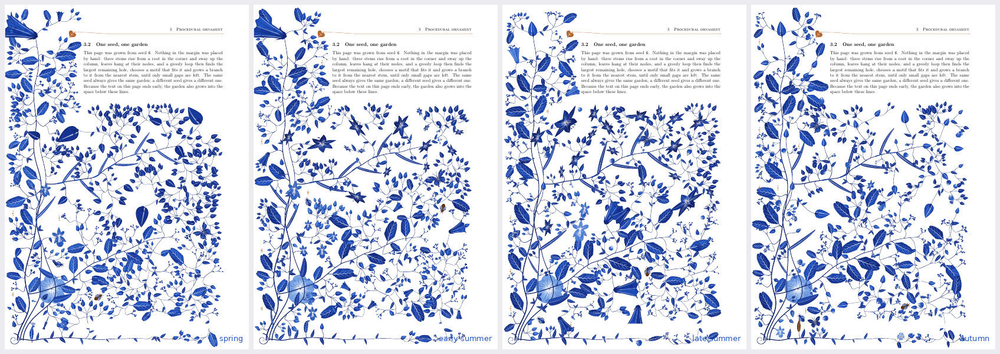

*One seed in spring, early summer, late summer and autumn. The seasons change what grows,
not where.*

## Visitors

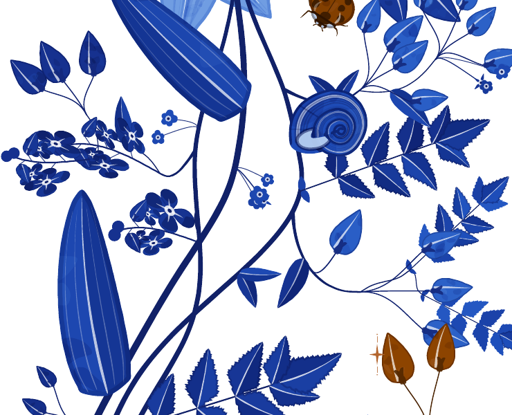

Most pages have visitors: a butterfly or two and bees in the open spaces, a snail crawling
up one of the main stems, and on about one page in five a bird perched on a twig of its own.
They come from a random stream of their own, so a page without them is exactly the page it
would have been; the option `novisitors` leaves them out.

## Any ink

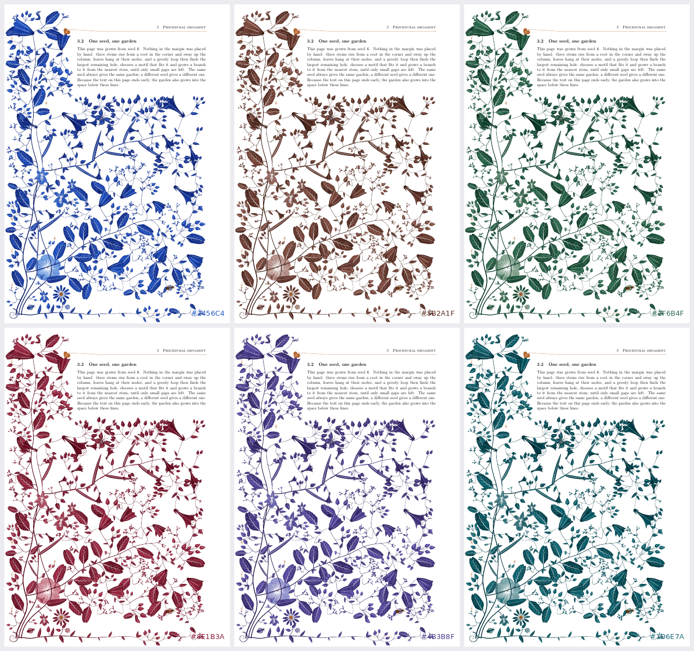

*The whole palette comes from one color, `ink`: Delft blue, sepia, green, crimson, violet,
teal. The ramp from the darkest stroke to the palest wash is computed from that hue in
OKLCH, so the light end never turns gray.*

## In PostScript


*`postscript/florilegium.ps`: the grown margin in pure PostScript, one self-contained file.
Ghostscript, or a printer, computes every petal while it interprets the page, and the
two pages of text explain how.*

The drawing core, every primitive and the growth loop are ported from `ink.lua`, `flora.lua`
and `grow.lua`, procedure for procedure. It needs no TeX and no other file:

```sh
gs -dALLOWPSTRANSPARENCY -sDEVICE=pdfwrite -dSeed=7 -o garden.pdf postscript/florilegium.ps
make postscript             # the same -> build/postscript-7.pdf; SEED=12 for another garden
```

`-dSeed=N` picks the garden; without it the clock picks one, so every print is new.
`-dAge=0` to `1` sets the season, and `-dNoVisitors` leaves out the butterflies, bees, snail
and bird. Two pages take about 2.5 seconds. Much of the Lua maps directly: PostScript's own
transformation matrix places each primitive (translate, rotate, scale), paths and Bézier
curves are native, and procedures built at run time stand in for Lua's closures (a petal's
half-width is a procedure handed to the outline builder). Four things don't map:

- **Layers.** The garden grows in one order but is painted back to front, so every fill and
  stroke is captured with `pathforall` into a list per layer, and the lists are played back
  at the end.
- **Transparency.** PostScript has none. Ghostscript provides it with `-dALLOWPSTRANSPARENCY`.
  Without that flag, or on a printer, each translucent fill is mixed with the color it is
  likely to land on and painted opaque. The result is flatter, but it's the same garden.
- **Randomness.** The generator is Park-Miller in 32-bit integer arithmetic, and PostScript
  reals are single precision, so seed 7 here is a different garden from seed 7 in LaTeX.
- **Text.** The file typesets its own two pages in Times. It knows where its headings are and
  where its text ends, so the copper flowers at the headings and the garden under the last
  line work as they do in LaTeX. It has no initials, animation or authored composition.


*The file sent twice to an Epson inkjet with `lp postscript/florilegium.ps`, with no seed
given. The computer's print system runs the program again for each job, so each print takes
its seed from the clock and grows a different garden. A printer gets the opaque version, as
it has no transparency.*

## Build

LuaLaTeX is the native route. A simple page can compile in one pass; references,
seasons and remembered positions need further passes. The build command manages
convergence for both engines:

```sh
python3 tools/build.py folio-demo.tex --engine lua --output-dir build/lua
python3 tools/build.py folio-demo.tex --engine xe --output-dir "build/XeLaTeX proof"
```

It uses no shell escape, runs the Xe vector renderer between passes, and checks
that records and auxiliary files settle before reporting success, including the
files written by included chapters and lists of figures/tables. Source filenames
and output directories containing spaces are supported. `--job-name` selects a
safe output basename. Plain `xelatex doc.tex`, `texlua florilegium-xe.lua doc`,
`xelatex doc.tex` also works from one directory; repeat when warned about stale
records. Prefer the build command for an output directory or a document with aging.

The established targets remain available:

```sh
make                        # the three PDFs
make seed-7                 # one page from seed 7 -> build/seed-7.pdf
make gallery                # gallery/seeds.png + seeds.gif, inks.png, seasons.png (python3, Pillow, pdftoppm)
make grow-6                 # growth animation of seed 6 -> build/grow-6.gif + .mp4 (ffmpeg)
make grow-6 EXPLAIN=1       # the same with the free discs marked -> build/grow-6-explain.*
```

No TeX installed? Build the image once and run everything in it:

```sh
docker build -t florilegium-tex tools
make RUN=tools/in-docker
```

For a ready-to-copy starting point, use [examples/book.tex](examples/book.tex).
`make source-package` creates `build/florilegium-v1.4-source.zip`, with the source,
examples, previews, license and a SHA-256 manifest. Extract it and build the template
with its own `tools/build.py`. `python3 tools/packagecheck.py` verifies that workflow.

For LuaLaTeX on [Overleaf](https://www.overleaf.com), copy `florilegium.sty`, the root
`.def` and `.lua` files and a document, then select LuaLaTeX. The portable Xe workflow
uses the external `texlua` pass; it is checked through the local build command rather
than assuming a hosted editor permits that command.

Use it in your own document:

```latex
\usepackage[grown]{florilegium}      % or plain \usepackage{florilegium} for the authored one
% options for the grown one: sections (flowers at the headings), aging (two runs),
% novisitors (no butterflies, bees, snails or birds)
\definecolor{ink}{HTML}{5B2A1F}      % optional: the hue of the whole palette (this is sepia)
\definecolor{accent}{HTML}{B4662F}   % optional: the copper of the hairlines
...
\florilegiuminitial[4]{T}his paragraph starts with a decorated T.
... a flower in the margin beside this line\florilegiumbloom ...
\florilegiumage{0.8}                 % grown only: autumn from here on
\florilegiumtextend                  % grown only: at the very end of the text
```

A fixed seed instead of the page number: `lualatex "\def\florilegiumseed{7}\input{florilegium-grow.tex}"`.

Any primitive can be drawn on its own inside a TikZ picture, under the current scope's
shift, rotation and scale:

```latex
\begin{tikzpicture}
  \begin{scope}[shift={(2,2)},rotate=20]\florilegiumdraw{flower}{1.3}\end{scope}
  \begin{scope}[shift={(5,0)}]\florilegiumdraw{leaf}{3.0, {depth=0.6}}\end{scope}
  \begin{scope}[shift={(8,1)}]\florilegiumdraw{ghost}{"lily", {s=1.4}}\end{scope}
  \begin{scope}[shift={(11,1)}]\florilegiumdraw{butterfly}{1.5}\end{scope}
\end{tikzpicture}
```

## How it works

**Drawing** (`ink.lua`). All geometry is computed in Lua and written as PDF path operators
into one literal node per page; TeX does no arithmetic. Primitives are drawn in a local
frame under an affine transform, which is read from TikZ when a primitive is called inside
a scope. Colors come from a tone ramp derived from the one document color `ink`: navy to
mist at the hue of `ink`, interpolated in OKLCH so the light end stays blue instead of
turning gray. Tapered strokes are two offset Béziers, not sampled ribbons.

**Primitives** (`flora.lua`). Painted in the order a watercolorist would: a flat wash,
darker blotches multiplied over it, pigment pooling at the edges, streaks lifted out in
white, a few fine veins, and almost no outlines. Broad petals and flowers, star lilies seen
at a tilt, blossoms and florets, buds and bellflowers; lobed and entire leaves; forget-me-not
cymes that curl like a scorpion's tail, branching sprigs, umbels, tendrils, seed heads;
butterflies, bees, snails and a bird; copper sparkles, rosettes and the ivy-leaf fleuron
whose stem becomes the head rule. Any of them can be painted as a pale ghost.

**Authored composition** (`authored.lua`). A plant grows from a root in the bottom-left
corner: three stems through hand-picked control points, a fourth along the bottom of the
page as the footer, leaves at chosen fractions of the stems, and every other motif on a
branch that leaves its stem tangentially and arrives along the motif's axis — so every
flower can be traced back to the root.

**Grown composition** (`grow.lua`), in the spirit of Wong, Zongker & Salesin,
[*Computer-Generated Floral Ornament*](https://dl.acm.org/doi/10.1145/280814.280948)
(SIGGRAPH 1998). The stems sway up the column as smooth noise of their height; leaves are
hung at their nodes where there is room. Then, repeatedly: take the largest free disc within
reach of a stem, choose a motif that fits it, and grow a branch to it from the nearest stem
point; the branch becomes a stem in turn. Big holes are taken first, so flowers and lilies
land early, sprays and leaves fill the middle, and the loop ends by tucking leaflets, buds
and florets onto the stems. The end of the text is measured with `\pagetotal` in the same
pass, so a short last page grows branches into the space below it with one compilation.

**Reading the page** (`florilegium.lua`). A heading or `\florilegiumbloom` leaves an
invisible marker node in the text. When the page is shipped out, its box is walked node by
node, adding up heights, depths and the glue as it was set, to find each marker's height on
the page; the garden then gives those lines their flowers before any leaf is hung. An age
reweights the motifs: buds and sprays of buds in spring, seed heads in autumn, when some
leaves are painted with a ramp built from the accent instead of the ink.

**Initials** (`initial.lua`). The letter's outline comes from luaotfload's OpenType reader as
Bézier segments. Flattened into polygons, it gives an even-odd inside test, and a grid of
distances to the letter and the frame finds the largest gaps for the flowers. The vine is a
Catmull-Rom curve across the tile; where it crosses the letter it goes over and under in
turn, and the strands that go over are drawn again, clipped to the letter, with a thin halo
of paper.

**Procedural ≠ random.** The seed is derived from the page number, so page *n* always
gets garden *n*. Reproducibility is what makes the document stable enough to typeset.

See [CLAUDE.md](CLAUDE.md) for a handoff-style map of the code, the tunables, and ideas not
yet done.

## License

MIT. See [ACKNOWLEDGEMENTS.md](ACKNOWLEDGEMENTS.md) for the original project and
the pinned fork contributions adapted here. [VALIDATION.md](VALIDATION.md) records
the checks and practical limits. [QC.md](QC.md) records the full review and repairs.
